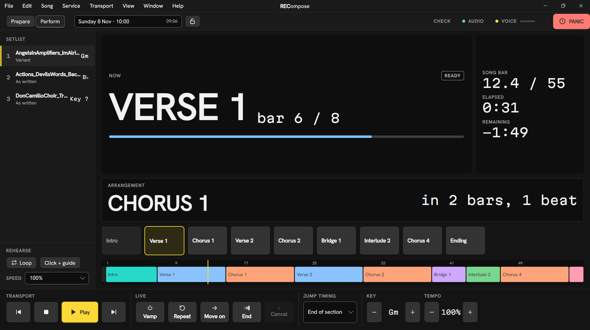
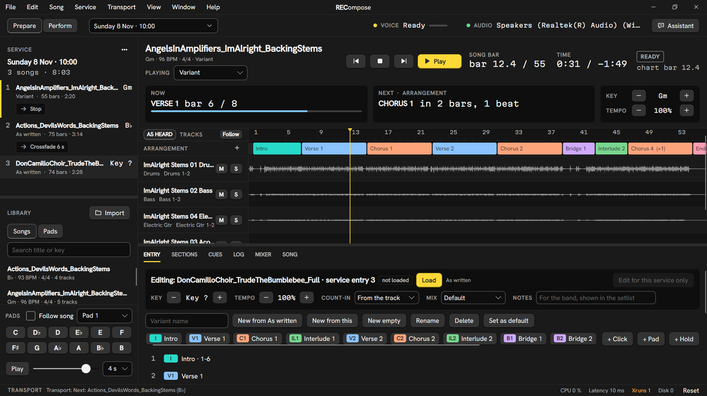

<div align="center">


# RECompose

**Live multitrack stem playback for church worship teams.**<br>
Shape each song for this week's service, rehearse it with the band, and run it live, hands-free, by voice, foot pedal or MIDI.

[](https://github.com/nathtjan/RECompose/releases/latest)
[](https://github.com/nathtjan/RECompose/actions/workflows/ci.yml)
[](LICENSE)


<a href="https://github.com/nathtjan/RECompose/releases/latest/download/RECompose-win-x64-Setup.exe"></a>
<a href="https://github.com/nathtjan/RECompose/releases/latest/download/RECompose-osx-arm64.dmg"></a>
<a href="https://github.com/nathtjan/RECompose/releases/latest/download/RECompose-osx-x64.dmg"></a>

[Install](#install) · [Getting started](#getting-started) · [Features](#features) · [Changelog](CHANGELOG.md) · [For developers](#for-developers)

</div>

<p align="center">
  
</p>

## Why RECompose

- **The arrangement is yours, every week.** Reorder, repeat and cut sections of any multitrack without editing audio, and change key and tempo per service.
- **Change the song while it plays.** Vamp, repeat, jump or end on the next bar or at the end of the section, with no gap, from a pedal, a MIDI controller or your voice.
- **Built not to stop.** The audio engine is a separate process: if the app closes or crashes, the music keeps playing. A fallback device and PANIC are always at hand.
- **Works offline.** Voice control and the spoken guide run on your computer. The assistant is optional and uses your own API key.

<p align="center">
  
</p>

## Install

Download the latest version from [Releases](https://github.com/nathtjan/RECompose/releases).

| System | Download | How to install |
|---|---|---|
| Windows, 64-bit | `RECompose-win-x64-Setup.exe` | Run it. It installs for your user account, with no administrator rights, and adds RECompose to the Start menu. |
| macOS 13 or later, Apple Silicon | `RECompose-osx-arm64.dmg` | Open it and drag RECompose to Applications. |
| macOS 13 or later, Intel | `RECompose-osx-x64.dmg` | Open it and drag RECompose to Applications. |

If a download isn't signed, Windows SmartScreen warns the first time: choose **More info**, then **Run anyway**. On macOS, right-click the app and choose **Open** the first time. macOS asks for the microphone the first time you use voice control; if you said no, **Settings** has a link to the system page.

**Updates:** the installed app checks for a new version after it starts, downloads it in the background and installs it when you quit. It never updates in Perform or while a song plays. Your settings, library and logs are kept across updates and reinstalls, in `%APPDATA%\RECompose` on Windows and `~/Library/Application Support/RECompose` on macOS. What changed in each version is in [CHANGELOG.md](CHANGELOG.md).

You need an audio interface or your computer's own output. A multi-output interface lets you send the click and guide to the band's in-ears and the music to front of house.

## Getting started

1. **Import a song.** Drag a folder of stems onto the window, or use **File › Import stems folder…** (Ctrl+I). Pad sets have their own **File › Import pad set…**. RECompose names each track (click, guide, drums, bass, keys and so on), reads the tempo and key, and finds the sections.
2. **Shape the arrangement.** Check the sections on the timeline, then build this week's order: Verse 1, Chorus, Verse 2, Chorus 2, Bridge, Chorus to the end.
3. **Build the service.** Add songs to a service and choose for each the arrangement, key, tempo, count-in, mix and the transition into the next song.
4. **Run Service › Service check.** It finds missing stem files, arrangements that won't play, keys and tempos still to render, and audio device problems, most with a button to fix them.
5. **Perform.** Press Ctrl+P (Cmd+P on macOS), or **View › Prepare or Perform**, for the Perform screen, then play the service with the keyboard, a page-turner, a foot pedal, a MIDI controller or your voice.

## Features

**Library and import**
- Imports a folder of stems, recognises click, guide and instrument tracks, and finds tempo, key and sections.
- Pad folders are recognised and shown for review before import; you can import either way.

**Arrangements**
- Reorder, repeat, cut and shorten sections with no editing of the audio.
- Section names in band words (Verse 2, Chorus 3), with checks for arrangements that won't play as written.
- Version history and undo for every change.

**Services**
- A song's arrangement, key, tempo, count-in, mix preset and transition (segue, crossfade or pad) for each service.
- Key and tempo changes play live, and can be rendered ahead of time for the best sound.
- Service export and import, to share a service with another computer.

**Pads**
- Ambient pad sets that follow the song's key, with a play/stop button and their own volume.
- Edit a pad set's files per key, loop points and volume, and make a missing key from the nearest one.

**Mixer and outputs**
- Per-track volume, mute and solo, track groups and mix presets.
- Route click, guide, music and pads to separate outputs.
- A fallback audio device: if the interface is lost, the click keeps time and playback moves to the fallback.

**Perform and live control**
- The Perform screen shows NOW, NEXT, the plan strip, a mini timeline and a key deck.
- Change the song while it plays, with no gap: jump to a section, vamp, repeat, move on, end or cancel. Holds wait for GO.
- Service lock guards against stray keys.
- Drive it with keys, a page-turner, a MIDI foot pedal or a MIDI controller, all set with Learn. Controllers can jump to sections, play pads, move faders, switch profiles and light up to show what is playing.
- Rehearsal loops a section with a count-in.

**Voice control**
- Talk into a talkback mic and RECompose follows band directions ("go to the bridge after this", "back to chorus two", "never mind") as it does a key or a pedal. Speech is recognised on your computer, with no internet connection.

**Spoken guide and automation**
- A spoken guide calls each section a bar ahead, and count-ins are spoken. When a live change makes the guide track's own call wrong, it is replaced.
- Section changes and cues go out over MIDI for lights and other software.
- A LOG tab and a service report record what happened in the service.

**Assistant (optional)**
- With your own Anthropic or OpenAI API key, type or dictate a change ("make song 3 short: V1, C, V2, C, end") and the assistant makes it, one undo step per message, and asks first in Perform. The key is kept in your system's credential store. Without a key, nothing is sent anywhere.

**Reliability**
- The audio engine is a separate process: if the app closes or crashes, the music keeps playing, and the app picks up where it was when it restarts. PANIC stops everything at once.

## Problems and feedback

If something goes wrong, RECompose shows a window with the details to copy into a bug report. Open an issue on [GitHub](https://github.com/nathtjan/RECompose/issues) with those details; the log is in the `logs` folder of the data folder above.

# For developers

## Stack

| Part | Technology | Where |
|---|---|---|
| UI and app logic | C# / .NET 10, [Avalonia](https://avaloniaui.net) 12 | `src/` |
| Audio engine | C++20 on [JUCE](https://juce.com) 9, a separate process (`recompose-engine`) the app talks to over a local socket | `engine/` |
| Design system "Instrument" | tokens, fonts, icons (source of truth for the UI) | `design/` |

Why this split is recorded in [docs/adr/0001-stack-and-architecture.md](docs/adr/0001-stack-and-architecture.md).

```
engine/            the engine process (CMake); docs/engine-protocol.md is the only interface
src/RECompose.Core     domain model, plan building, readouts, import rules (pure, unit-tested)
src/RECompose.Engine   engine client: starts or reattaches to the engine, speaks the protocol
src/RECompose.Presentation  view models and app services (no UI framework, tested against the engine)
src/RECompose.App      Avalonia desktop app
tests/             xUnit v3 tests, including headless window tests (RECompose.App.Tests)
tools/             generators for design resources (tokens, icons) and CI helpers
design/            tokens.json, fonts, icons, design-system notes
docs/              decisions, the engine protocol, design and test notes
```

## Build

### Prerequisites

| | Windows 11 | macOS 13+ |
|---|---|---|
| C++ | Visual Studio 2022 or 2026 (Community or Build Tools) with **Desktop development with C++** | Xcode command line tools (`xcode-select --install`) |
| CMake | 3.22 or later (Visual Studio includes one) | `brew install cmake` |
| .NET | [.NET 10 SDK](https://dotnet.microsoft.com/download/dotnet/10.0) | same |
| Git | Git for Windows | included with the command line tools |

Linux builds and runs the tests (CI does, on Ubuntu 24.04) but is not a release platform. It needs a C++ compiler, CMake, the .NET 10 SDK and `sudo apt-get install libasound2-dev libfreetype-dev libfontconfig-dev ninja-build espeak-ng`.

The first engine build downloads JUCE 9.0.4 (about 130 MB) and whisper.cpp 1.9.5 and takes a few minutes.

Guide transcription needs the speech model `ggml-base.en.bin` (142 MiB, MIT). The CI builds ship it in `models/` next to the app. A development build downloads it on first use into `<data folder>/models/`, or set `RECOMPOSE_SPEECH_MODEL` to a copy.

### Build, test and run

```powershell
# Windows (PowerShell)
.\build.ps1
dotnet run --project src/RECompose.App
```

```bash
# macOS / Linux
./build.sh
dotnet run --project src/RECompose.App
```

The script builds the engine with CMake, runs its tests, copies `recompose-engine` to `artifacts/native/bin/`, then builds and tests the .NET solution (the build copies the engine next to the app). After changing only C# code, `dotnet build` / `dotnet test` / `dotnet run` are enough.

CI builds and tests every push on Windows, macOS and Linux, and attaches a runnable app for Windows (`RECompose-win-x64`) and macOS (`RECompose-osx-arm64`) to each run. A tag such as `v0.3.0` builds the installers and publishes a release ([docs/packaging.md](docs/packaging.md)).

## Licence

RECompose is free software under the [GNU Affero General Public License v3.0 or later](LICENSE). It uses JUCE under its AGPLv3 option. Bundled fonts and other third-party parts are listed in [THIRD-PARTY-NOTICES.md](THIRD-PARTY-NOTICES.md).
